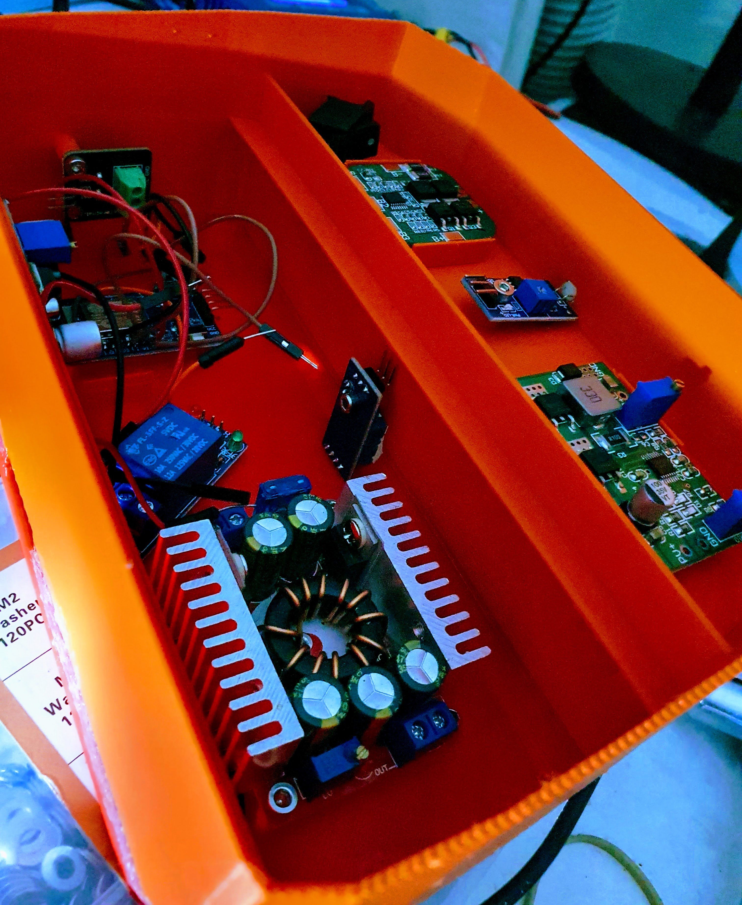
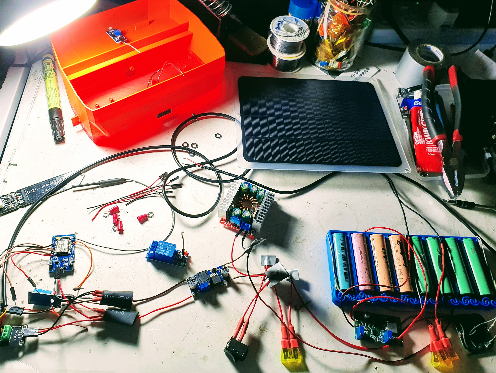
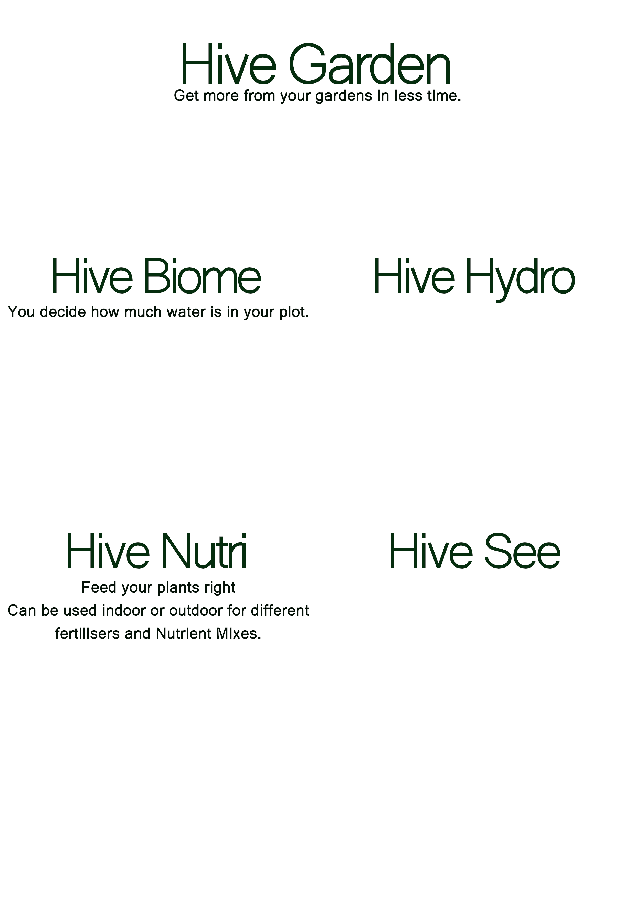

# Garden automation (Hive Garden / Hive Biome)

An automated garden watering system I designed and built: soil moisture, temperature and light sensing, a pump/solenoid driven from a relay, and sensor readings posted to a small PHP endpoint.

**Matt Harmer** · Lake Macquarie, NSW · [LinkedIn](https://www.linkedin.com/in/matt-harmer-me/) · [GitHub](https://github.com/mattharmer/Garden_Automation)

This is a personal workshop build, also noted in the workspace as Hive Biome / Hive Garden. It is not a commercial product.

---

## Problem

I wanted a plot to water itself when the soil was dry, and to keep a simple record of moisture, temperature, humidity, light and how long the pump had run, without standing over it.

## What I built

An ESP8266 reads:

- a capacitive soil-moisture sensor (CSMS-V2)
- a DS18B20 soil temperature probe
- a DHT11 for air temperature and humidity
- an LDR (TZT) for light / shade

and switches a 5 V relay to run a pump when the soil reading crosses a threshold. The firmware averages readings over about an hour and POSTs them to `public_html/post-sensor.php`. A pinout for the board is in `PINOUT.txt`. There is also a KiCad project in `schematic/`, 3D-printed case parts in `design/`, and a small Pygame garden-bed sketch in `gardenplan/`.

The original firmware and PHP on this repository had Wi-Fi, database and API credentials in the source. Those have been replaced with placeholders (`YOUR_WIFI_SSID`, `YOUR_DB_PASSWORD`, `YOUR_API_KEY`, and so on). Use a local config or environment values before you run it, and do not commit real secrets. Earlier commits may still contain the old values, so rotate the Wi-Fi, database password and API key if those services are still in use.

## Photos

| Image | What it shows |
| --- | --- |
|  | Electronics in the 3D-printed orange controller case |
|  | Bench build: case, solar panel, cells, relay, pump wiring and sensors |
|  | Hive Garden / Hive Biome naming concept |

Part close-ups (buck converter, BMS board) are in `images/parts/`. Module reference photos and STLs are in `design/`.

## What's in this repository

| Path | What's there |
| --- | --- |
| `main.cpp` | ESP8266 firmware (Wi-Fi and API key are placeholders) |
| `post-sensor.php` | PHP endpoint, also kept at the repo root for compatibility, with database secrets replaced by placeholders |
| `public_html/` | The same PHP, plus a small light-value writer |
| `PINOUT.txt` | ESP8266 pin map from the workshop notes |
| `schematic/` | KiCad project (`autowater`) |
| `design/` | Case and cover models, module photos |
| `documents/` | Component list |
| `datasets/` | Plant-guide CSVs I collected for later use |
| `gardenplan/` | Early Pygame sketch of garden beds |
| `images/` | Photos of the build |

Workshop notes also list later ideas (a custom PCB, a second case, SSL, device login). Those are notes, not a claim that they were finished.

## What this shows

A complete loop from sensors and a relay through to a small server endpoint, with the case and the board mapped so someone else can follow it — and a reminder that secrets belong in config, not in the source.
